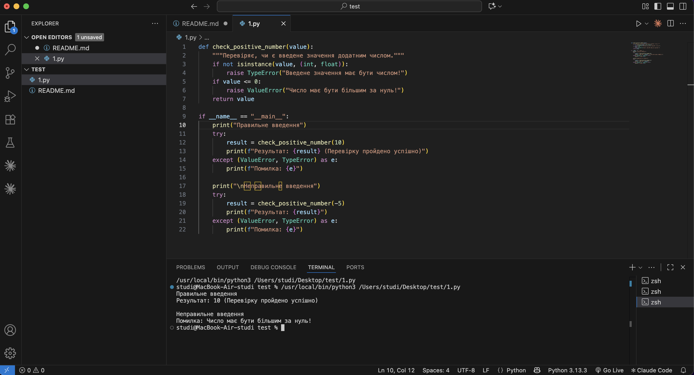
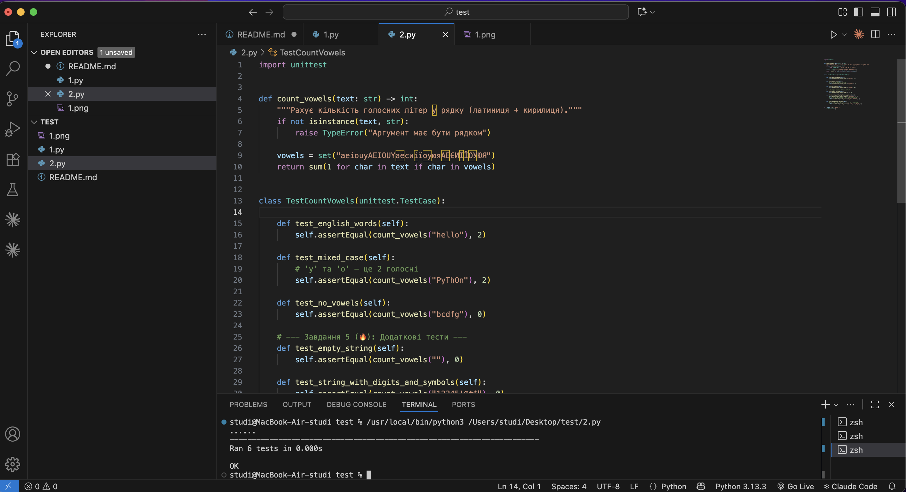
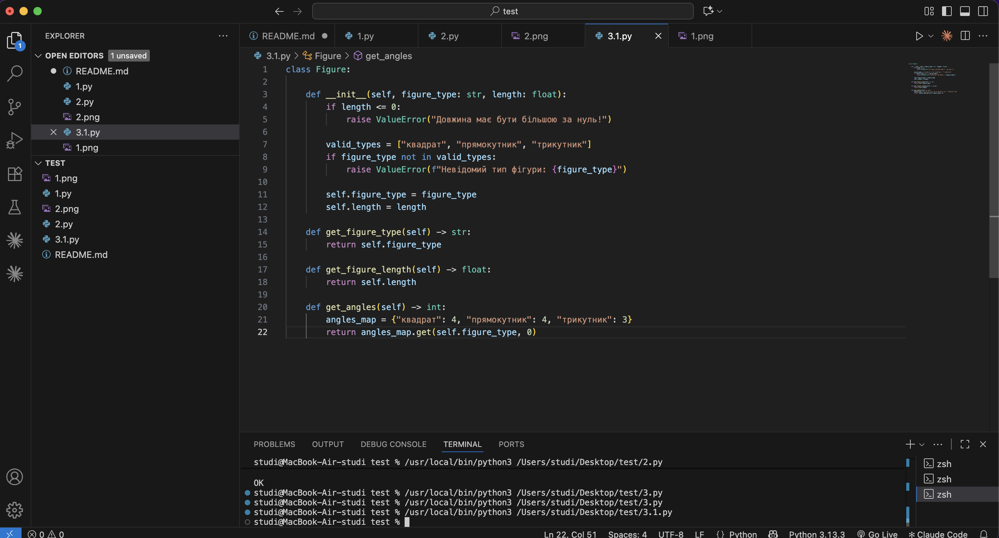
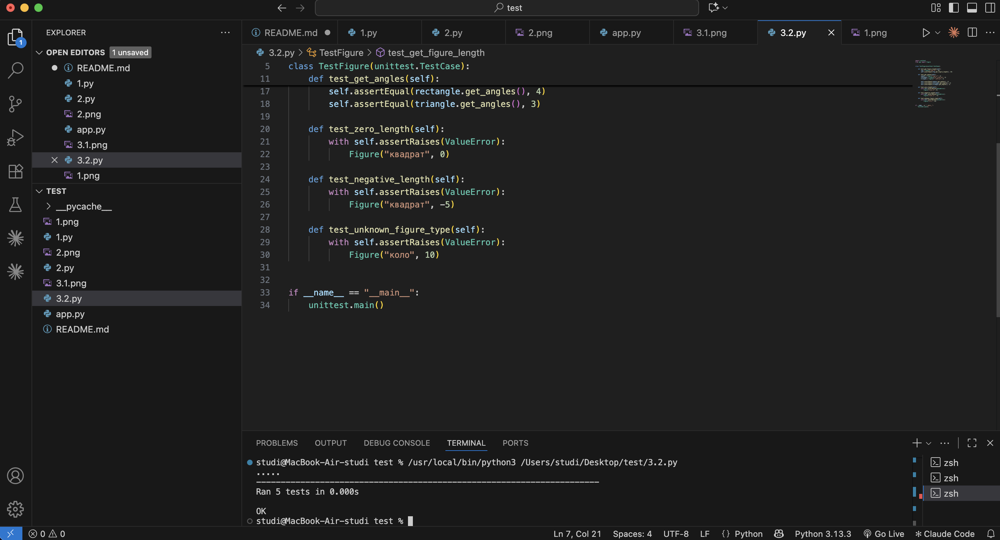
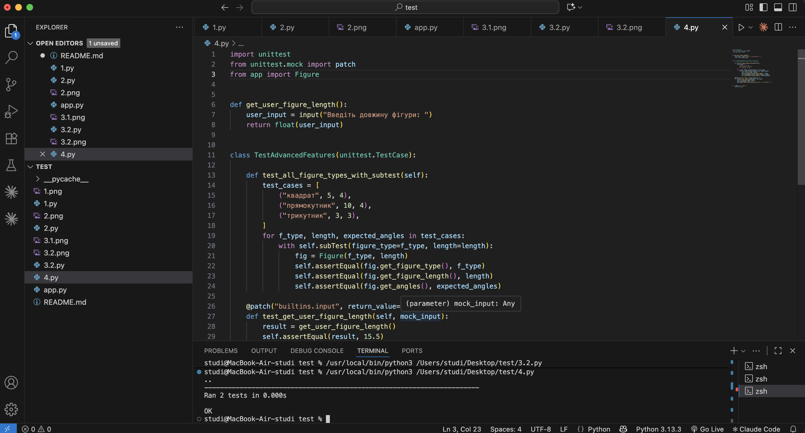

**Звіт до Роботи**

**Тема роботи: Загальне тестування та Unit тестування**

**1.Загальне тестування та юніт-тести**

**1.1.Перевірка даних — Завдання 3**

**1.2.Тестування функцій — Завдання 4**

**1.3.Тестування функцій — Завдання 5**

**2.Перший приклад**

**1.1.Перший приклад — Завдання 5**

**1.2.Перший приклад — Завдання 6**

**1.3.Перший приклад — Завдання 7**

**3.Розширені можливості**

**1.1.Розширені можливості — Завдання 4**

**1.2.Розширені можливості — Завдання 5**

**1.Запуск окремих тестових файлів здійснюється з терміналу VS Code за допомогою таких команд:**

Bash
# Запуск перевірки введеного числа
python 1.py

# Запуск юніт-тестів для підрахунку голосних
python 2.py

# Запуск юніт-тестів для класу Figure
python app.py

# Запуск розширених тестів (subTest та mock.patch)
python 4.py

**2.Результат виконання тестів**

studi@MacBook-Air-studi test % python3 -c "import unittest; from importlib.machinery import SourceFileLoader; suite=unittest.TestSuite(); [suite.addTests(unittest.defaultTestLoader.loadTestsFromModule(SourceFileLoader('test'+str(i), f'{f}.py').load_module())) for i,f in enumerate(['1','2','3.2','4'])]; unittest.TextTestRunner(verbosity=2).run(suite)"
test_empty_string (test1.TestCountVowels.test_empty_string) ... ok
test_english_words (test1.TestCountVowels.test_english_words) ... ok
test_mixed_case (test1.TestCountVowels.test_mixed_case) ... ok
test_no_vowels (test1.TestCountVowels.test_no_vowels) ... ok
test_string_with_digits_and_symbols (test1.TestCountVowels.test_string_with_digits_and_symbols) ... ok
test_ukrainian_letters (test1.TestCountVowels.test_ukrainian_letters) ... ok
test_get_angles (test2.TestFigure.test_get_angles) ... ok
test_get_figure_length (test2.TestFigure.test_get_figure_length) ... ok
test_negative_length (test2.TestFigure.test_negative_length) ... ok
test_unknown_figure_type (test2.TestFigure.test_unknown_figure_type) ... ok
test_zero_length (test2.TestFigure.test_zero_length) ... ok
test_all_figure_types_with_subtest (test3.TestAdvancedFeatures.test_all_figure_types_with_subtest) ... ok
test_get_user_figure_length (test3.TestAdvancedFeatures.test_get_user_figure_length) ... ok

----------------------------------------------------------------------
Ran 13 tests in 0.001s

**3.Тест, який спочатку не проходив, та його виправлення***

При виконанні 2.py тест test_mixed_case повертав помилку FAIL:

FAIL: test_mixed_case (2.TestCountVowels)
Traceback (most recent call last):
  File "/Users/studi/Desktop/test/2.py", line 19, in test_mixed_case
    self.assertEqual(count_vowels("PyThOn"), 1)
AssertionError: 2 != 1

Причина помилки: У слові "PyThOn" присутні дві голосні літери (y та o), але в очікуваному результаті тесту було помилково вказано значення 1.

Виправлення:

def test_mixed_case(self):
    # 'y' та 'o' — це 2 голосні
    self.assertEqual(count_vowels("PyThOn"), 2)

**4.Пояснення призначення subTest та mock у власному прикладі**

Призначення subTest (у файлі 4.py):

subTest використовується для параметризованого тестування декількох наборів даних у межах одного тестового методу.
Перевага: Якщо один з параметрів (наприклад, для "прямокутник") зазнає невдачі, виконання тесту не зупиняється на ньому. unittest перевірить усі інші параметри ("квадрат", "трикутник") та точно вкаже, на яких саме даних стався збій. 

Призначення mock / patch (у файлі 4.py):

Декоратор @patch("builtins.input", return_value="15.5") ізолює тест від зовнішнього інтерактивного введення.
Перевага: Він підміняє стандартну системну функцію input() на об'єкт-макет (mock), який автоматично повертає заздалегідь визначений рядок "15.5". Це дозволяє повністю автоматизувати тестування функцій з користувацьким введенням без зупинки програми та очікування ручних дій користувача

